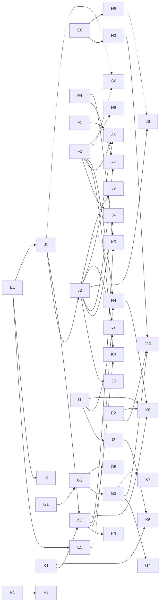

# PLAN: from `fp-go-harness` to a complete coding-agent harness

This plan was worked out from the recorded agent sessions
(7 JSON-lines logs, 2026-09-24 … 2026-10-06). Each phase is a list of small steps, and each
step is meant to fit in one PR with its own test.

---

## 0. What the recordings show

What a recorded session does, taken from the `HarnessProvider.payload`, `ChatManager` and `Gateway` log records:

| Aspect | What the recordings show |
|---|---|
| Request | `model`, `max_tokens: 20000`, `tool_choice: "auto"`, `stream: true`, `stream_options.include_usage: true`, ~30 tool definitions |
| System prompt | ~65 KB of tagged sections: `role_definition`, `investigate_before_answering`, `engineering_discipline`, `tool_use`, `markdown_rules`, `auto_appended_context`, `base_rules`, `available_skills`/`skill`*, `user_custom_instructions`, `project_rules`/`agents_md`/`rule`, `environment_info`, `available_modes` |
| User turn | User text plus an `<environment_details>` block: `current_datetime`, `current_mode`, `active_file`, `git_status_snapshot`, `external_changes` |
| Loop | `Task setup complete` → `Starting agent loop` → *n* × (request → `Assembled chat response` with `finishReason: tool-calls` → `Tool invoked`) → `Agent loop completed` |
| Steering | `Steering agent`: the user adds a message while the loop is still running |
| Multi-turn | A finished task is resumed later with a new user message on the same history (`taskId` stays the same; the task is persisted in `TaskStore`) |
| Tool usage (count) | `execute_command` 49, `grep` 9, `read_file` 8, `search_and_replace` 4, `write_file` 3, `use_skill` 3, `apply_diff` 1 |
| Tool errors | Tool errors go back to the model as plain tool-message text (e.g. `path must be an absolute path …`). The loop never fails because of a tool error. |
| Background processes | `execute_command` with `background: true` returns a pid and a log path. The model then reads the log with `read_file`. |
| MCP | MCP tools are named `mcp__<server>__<tool>` (e.g. `mcp__fp-go__get_example`). There is a stdio transport, servers can be reconnected, and a server that fails to start is skipped. |
| Usage | Input, output, cache-read and reasoning tokens for each request |
| Gateway | Every HTTP request is logged with its elapsed time. On a 401 the token is refreshed and the request retried once. |

What the harness has today:

- [`openai.ChatCompletion`](openai/request.go): one non-streaming call, as a `Kleisli[ChatCompletionDeps, Params, *ChatCompletion]`.
- [`openai.MakeDeepSeekChatCompletionDeps`](openai/deepseek.go): provider wiring (env + HTTP).
- [`tools.HandleToolCalls`](tools/tools.go): runs tool calls through a `ToolCaller` registry. Errors become tool messages.
- [`session.Next`](session/session.go): one step of the loop as a `Trampoline`, with history, usage monoid and iteration counter.
- [`main.go`](main.go) is empty. There are no real tools, the loop is never driven to the end, and there is no system prompt assembly, persistence or streaming.

---

## 1. fp-go rules for every step

These apply to every phase. Before writing a combinator, check it with the `fp-go` MCP server
(`mcp__fp-go__search_examples`, `mcp__fp-go__get_example`, `mcp__fp-go__use_skill`).
Don't write signatures from memory.

1. **Dependencies are interfaces with getters.** Follow the `XxxDeps` / `MakeXxxDeps` / `AsXxxDeps[R XxxDeps](r R) XxxDeps` pattern
   (see [env/env.go](env/env.go), [http/http.go](http/http.go)). Bigger dependency sets embed smaller ones
   (see `SessionDeps`, `DeepSeekDeps`).
2. **Effectful operations are `effect.Kleisli[Deps, In, Out]`.** Build them with `effect.Asks`, `Map`, `Ap`, `Chain`,
   `FromThunk` and `ChainThunkK` (see [AGENTS.md](AGENTS.md)). To reuse an existing Kleisli in a wider
   environment, use `effect.Local[A](AsXxxDeps[Wider])`. Don't rebuild the double-`Reader` shape by hand.
3. **Use point-free `F.Flow`/`F.Pipe` with named intermediate values**, as in `session.Next`.
   No `if err != nil`, no imperative loops, no mutation outside lenses.
4. **Change state through optics.** Add `// fp-go:Lens` to new structs and run `go generate`.
   Reuse the lenses generated for the openai types (extend the `//go:generate` lists in
   [openai/doc.go](openai/doc.go) and [tools/doc.go](tools/doc.go) as needed).
5. **Model tool failures as data.** A failed tool returns a tool message. It never fails the `Effect`
   (this is how [`tools.MakeToolCall`](tools/tools.go) works today). Only infrastructure errors
   (network, auth, cancellation) use the `Result` error channel.
6. **Combine values with monoids**: usage, endomorphisms over `ChatCompletionNewParams`, and prompt sections.
7. **Loops are stack-safe.** Use `tailrec.Trampoline` (`Bounce`/`Land`). Never use recursion inside `Effect`.
8. **Wrap side effects at the edge.** Use `ioresult.Eitherize*`, `result.TryCatchError` and `thunk.FromIOResult`.
   Wrap each OS/SDK call once, behind a `Deps` getter, so tests can replace it.
9. **Type aliases go in each package's `types.go`**, like the existing packages.
10. **Clean up afterwards.** Run `runCodeActions.bat` to remove unneeded type arguments, then `go vet ./...` and `go test ./...`.

---

## 2. Phases and steps

### Phase A: Close the loop (smallest working agent)

- [x] **A1 Clean up TODOs.** Move `headPrism` ([session/session.go](session/session.go)) and
  `effectFromReaderResult` ([tools/tools.go](tools/tools.go)) to a small `internal/fpx` package.
  First check whether fp-go already has them (`A.Head` prism, `effect.FromReaderResult`) and use
  those if it does. *Test:* the existing tests pass.
- [x] **A2 Loop driver.** Add `session.Run() effect.Kleisli[SessionDeps, Session, FinalResult]`, which drives
  `Next` to `Land`. Use an effect-level tailrec combinator if fp-go has one; otherwise write one helper in `internal/fpx`.
  *Test:* a fake `ChatCompletionDeps` that returns `tool_calls` twice and then `stop` → 3 iterations,
  history length 2, usage summed.
- [x] **A3 Iteration limit.** Add a `MaxIterations` option to `SessionDeps` (getter). When it is reached, `Next` lands
  with a typed error result. *Test:* a fake that always returns tool calls stops at N.
- [x] **A4 Tool definitions in the request.** `ToolCaller` is a lookup only, so the model never sees the tools.
  Add `ToolRegistry` (name → `{definition openai.ChatCompletionToolUnionParam, call ToolCall}`). Derive
  `ToolCaller` from it, and add an endomorphism that puts `Tools` into `ChatCompletionNewParams`.
  *Test:* the registry serialises to the expected JSON schema.
- [x] **A5 `main.go` CLI.** Read a prompt from the arguments, use ask mode (`openai.ForAskMode`) with
  DeepSeek, run `session.Run` and print the final message and usage. Compose all wiring as
  `Effect`s and run them only once, in `main`. *Test:* a manual smoke test with `DEEPSEEK_API_KEY`.

### Phase B: Replay fixtures from the recordings

These come before the real tools so that every later step can be tested against real traffic.

- [x] **B1 Log reader.** Add a `replay` package that streams JSONL records (`ts`, `level`, `module`, `msg`, `taskId`, `data`)
  as an `IOResult` sequence. *Test:* it parses the small 2026-09-24 log.
- [x] **B2 Payload extraction.** Use a prism to pick out `HTTP request body for /chat/completions:` and
  `Assembled chat response:` records and decode them into `openai.ChatCompletionNewParams` and a
  response DTO. *Test:* the payload count matches the counts above (126 requests, 71 responses).
- [x] **B3 Task grouping.** Group the records by `taskId` into `[]Turn` (request, response, invoked tools).
- [x] **B4 Replay `ChatCompletionDeps`.** Make a fake that answers with the recorded responses in order.
  Then `session.Run` replays a recorded task end to end without a network.
- [ ] ~~**B5 Copy the fixtures.**~~ *Skipped:* the recordings are not
  available. Copy 2–3 redacted tasks into `testdata/` (no tokens or internal URLs).
  Remove secrets with an endomorphism over the parsed records.

### Phase C: Core tools (in order of recorded use)

Each tool is its own `tools/<name>` file. It provides a `ToolRegistry` entry, a typed args struct
(decoded with `J.Unmarshal` into `Result`), its own `XxxDeps` (filesystem/process access behind getters)
and a text result. Validation errors (such as "path must be absolute") come back as tool text.

- [x] **C1 Workspace dependency.** Add `WorkspaceDeps` with `GetWorkspaceRoot()` and path resolution/validation as a
  `ReaderResult[string, string]`.
- [x] **C2 `read_file`.** Read a file with line numbers and an optional `range` (`start-end`). Output format:
  `Contents of file X:\n\n1 | …`, matching the recordings.
- [x] **C3 `list_files`, `glob`.** Implement with `io/fs.WalkDir` behind a getter; return paths relative to the workspace.
- [x] **C4 `grep`.** Search with `regexp` (or call `rg` when it is installed, through `ProcessDeps`). Support
  `include`, `ignore_case`, `invert_match`, `word_regexp`, `files_with_matches`, cap the results at 100 and group them by file.
  Skip what `.gitignore` files exclude (`github.com/go-git/go-git/v5/plumbing/format/gitignore`): `.git/info/exclude`,
  the `.gitignore` files from the workspace root down to the searched directory, and those below it.
  Not done yet: the `rg` fallback (needs `ProcessDeps` from C5) and `core.excludesFile`.
- [x] **C5 `execute_command` (foreground).** Add `ProcessDeps` (`exec.CommandContext` wrapped once).
  Support `cwd` and `timeout_seconds` through `context.WithTimeout` inside the `Thunk`.
  Output format: stdout plus a `Stderr:` section, and the exit code if it is not zero.
  A non-zero exit code fails the call, so the model sees `Exit code: N\n\nStdout:\n…\n\nStderr:\n…`
  as the tool error, as recorded. `background` is not in the definition yet (C6).
- [x] **C6 `execute_command` (background).** Start the process, send its output to a log file and return the pid and path
  (format as in the recordings). Register the process in an `IORef`-backed table owned by `ProcessDeps`.
  The result text was written without comparing it to the recordings. The log directory is a parameter of `MakeDefaultProcessDeps`; it has to lie inside the workspace so that
  `read_file` can read the logs. Processes leave the table when they exit. `StopProcesses()` (E4) kills them: the shell process only, its children may survive.
- [x] **C7 `write_file`.** Write the whole file and create parent directories. Check `line_count` to detect truncated content.
  Content with fewer lines than `line_count` fails as truncated; more lines pass, because models miscount the last line.
  The definition and the result text were written without comparing them to the recordings. Registered in the CLI
  without approval until I1.
- [x] **C8 `search_and_replace`.** Replace literal text or a regex, optionally within a line range. Implement it as a pure
  `Endomorphism[string]` with I/O only around it.
  A search without a match fails, so the model learns that its search text is stale. The file is edited with LF line
  endings and keeps CRLF if it has them, so multi-line searches match what `read_file` shows. The definition and the
  result text were written without comparing them to the recordings. Registered in the CLI without approval until I1.
- [x] **C9 `apply_diff`.** Parse `SEARCH`/`REPLACE` blocks. Applying them is a pure `func(string) Result[string]`
  (fold over the blocks, fail on the first block that doesn't match).
  Each block replaces one literal occurrence: the one nearest its optional `:start_line:`, else the first.
  The file is edited with LF line endings and keeps CRLF if it has them. The definition and the result text
  were written without comparing them to the recordings. Registered in the CLI without approval until I1.
- [x] **C10 `insert_content`.** Insert lines at a given line, or append when the line is 0.
  The content always ends with a line break, and a file without a final line break gets one, so the
  inserted lines never join a neighbour. A line beyond the end of the file appends. The file is edited
  with LF line endings and keeps CRLF if it has them. The result text was written without comparing it
  to the recordings. Registered in the CLI without approval until I1.
- [x] **C11 Output limits.** Add a monoid-free wrapper `tools.Truncate(n)` that shortens oversized tool output (the recordings
  contain 37 KB results) and adds a note that the output was truncated. Apply it to every tool as a
  `ToolCall` → `ToolCall` endomorphism.
  `tools.TruncateTools()(n)` applies it to a whole registry; the CLI limits every tool to 50,000 bytes.
  The limit counts bytes and never splits a UTF-8 sequence. Error text is cut too, because it is
  the tool message; shorter errors are kept as they are. The note was written without comparing it
  to the recordings.

### Phase D: Prompt assembly

- [x] **D1 `PromptSection` monoid.** Define `type Section = Pair[tag, body]`, render it as `<tag>\nbody\n</tag>` and
  concatenate sections with `A.Fold` and a string monoid.
  In the `prompt` package, `RenderSections` is `A.FoldMap` over `RenderSection` with
  `S.IntersperseMonoid("\n\n")`: a blank line between sections, and an empty rendering adds no
  separator. Not wired into the CLI yet (D2–D5).
- [x] **D2 Static sections.** Embed (`//go:embed`) role_definition, base_rules, tool_use and markdown_rules as files
  under `prompts/`, as `ask.txt` is today.
  `prompt.StaticSections()` returns them in the recorded order (role_definition, tool_use, markdown_rules,
  base_rules) from `prompt/prompts/*.txt`, with LF line endings and no trailing line break. The texts were
  written without comparing them to the recordings. Not wired into the CLI yet (D5).
- [x] **D3 `environment_info`.** Build it as an `Effect[EnvInfoDeps, Section]` from OS, shell, workspace root and date.
  `prompt.EnvironmentInfo()` reads the OS, architecture, shell and workspace root as a `Reader` over
  `EnvInfoDeps` (which embeds `tools.WorkspaceDeps`) and the clock as an `IO` getter, so tests fix the date.
  `MakeDefaultEnvInfoDeps` uses `runtime.GOOS`/`GOARCH` and `io.Now`. The body follows the recorded
  `### Workspace Info` / `### Command Execution Environment` headings; the OS release is not included.
  Not wired into the CLI yet (D5).
- [x] **D4 `project_rules`.** Read `AGENTS.md` (and `.bob/rules*`) from the workspace and wrap it as `<agents_md><rule>…`.
  A missing file gives `option.None`, which yields no section.
  `prompt.ProjectRules()` is an `Effect[ProjectRulesDeps, Option[Section]]` (workspace, `tools.FileDeps`,
  `tools.WalkDeps`). `AGENTS.md` becomes `<agents_md><rule>…</rule></agents_md>`, followed by one `<rule>` per
  file directly in `.bob/rules/`, in lexical order. Missing or empty files and a missing directory are left
  out; other read errors fail. Mode-specific `.bob/rules-<mode>/` directories wait for D5. Not wired into the
  CLI yet (D5).
- [x] **D5 Mode definitions.** Generalise `openai/modes.go` to a `Mode{ID, Name, Prompt, AllowedTools}`
  table (Agent, Plan, Ask). The system prompt and tool list for a mode are
  `Effect[ModeDeps, ChatCompletionNewParams]`.
  The [`mode`](mode/) package replaces `openai/modes.go` and the CLI's own mode table. `mode.Modes()` lists
  Agent (every tool), Plan and Ask (the read-only tools); each is a Markdown file in `mode/modes/`, with id, name, description, order and tools in its
  YAML front matter (split by `mode.SplitFrontMatter`, decoded with `go.yaml.in/yaml/v3`; unknown keys and tools are rejected) and the role
  prompt as its body, so a new mode is a new file (`mode.ReadModes` reads them from any `fs.FS`). Plan's
  was written without comparing it to the recordings. `mode.Request()` is an
  `effect.Kleisli[ModeDeps, Mode, ChatCompletionNewParams]`: the system prompt as the only message, rendered from
  role_definition (the mode's prompt, which replaces the static `role_definition.txt`), the static sections
  (without the rules that name a tool the mode doesn't allow, so Plan and Ask aren't told to write files),
  project_rules and environment_info, plus the definitions of the tools the mode allows (`tools.SelectTools`).
  `prompt.ProjectRules()` now takes the mode's ID and adds the rules in `.bob/rules-<id>/` after those in
  `.bob/rules/`. `ModeDeps` takes the workspace, files and listings from `tools.ToolsDeps`, so the prompt
  reads the workspace the tools work in. The CLI (`--mode agent|plan|ask`) uses it, so D1–D4 are now wired in.
  The `available_modes` section waits for H5.
- [x] **D6 `<environment_details>` per turn.** Add an endomorphism that wraps each user message with datetime, mode
  and git status (`git status --porcelain` through `ProcessDeps`). *Test:* golden file against a recorded user message.
  `prompt.EnvironmentDetails()` is an `effect.Kleisli[EnvDetailsDeps, string, Endomorphism[string]]` over the mode's
  name: the user's text, a blank line, then `<environment_details>` with `current_datetime` (UTC, milliseconds),
  `current_mode` and `git_status_snapshot` (`git status --porcelain --branch` in the workspace root, through the
  `RunProcess` of `tools.ProcessDeps`, in a code fence). A non-zero exit code (no repository) leaves the git
  section out; a git that cannot be started fails the effect. The golden file follows the shape of a current user
  message, since the recordings are not available (B5). The CLI wraps its prompt with it; `active_file` and
  `external_changes` wait for an editor and I3.
- [x] **D7 Replay comparison.** Compare the assembled system prompt section by section with a recorded one (tag order and presence).
  `prompt.SectionTags` lists the tags of the top-level sections of a rendered prompt (a line that is only an opening tag
  starts a section, the line that closes it ends it, nested tags are skipped), and `prompt.CompareSections` compares a
  recorded prompt with an assembled one as a `SectionDiff`: the tags missing and extra, and the shared ones in each
  prompt's order. `replay.SystemPrompt` reads the system message of a recorded request (a string or text parts, joined
  by line breaks) and `replay.SystemPrompts` yields one per request of a log. The recording is synthetic
  (`mode/testdata/recorded-system-prompt.log`, the tags of §0 in their order), since the real ones are not available (B5).
  The test fixes the gap: the Agent prompt lacks investigate_before_answering, engineering_discipline,
  auto_appended_context, available_skills (H1), user_custom_instructions and available_modes (H5), adds nothing,
  and keeps the recorded order.
- [x] **D8 Custom modes.** Read the mode files of `~/.bob/modes/` and `<ws>/.bob/modes/` with `mode.ReadModes` over
  `os.DirFS` (a missing directory is no modes, `ioresult.CatchIs(fs.ErrNotExist, …)`), and merge them with the built-in
  ones: the workspace wins over the home directory, both over the built-ins, by `id` (precedence is a monoid, as in G1).
  Two files with the same `id` in one directory are an error. `Lookup` and `IDs` take the merged table through
  `ModeDeps`. *Test:* `fstest.MapFS` per directory; an override, a new mode and a duplicate.
  `mode.ReadModeDirs()` is a `Reader[func(string) fs.FS, ioresult.Kleisli[[]string, []Mode]]`: the reader's function
  opens a directory (`os.DirFS` in the CLI, a map of `fstest.MapFS` in the tests), the directories are read
  concurrently, lowest precedence first. Each one is indexed by `mode.IndexModes` (a duplicate `id` is an error with the
  directory in it), and `mode.MergeModes` merges the indexes over the built-in modes with `R.UnionLastMonoid`, sorted
  by order, then id. No `CatchIs` was needed: `fs.Glob` already ignores the error of reading a missing directory, so
  it has no modes. `ModeDeps` embeds the new `ModeTableDeps` (`GetModes`), and `Lookup` and `IDs` are readers over it.
  The CLI reads the table from `~/.bob/modes/` and `<ws>/.bob/modes/` before it looks the mode up; `--help` lists the
  built-in modes and names the two directories.

### Phase E: Session lifecycle

- [x] **E1 Multi-turn.** Add `session.Continue(userText)`, an endomorphism that appends a user message to `current` and
  resets the per-turn iteration counter. History is kept.
  `session.Continue()` is a `func(string) Endomorphism[Session]`; usage keeps accumulating over the turns. Before this
  step a landing `Next` dropped the model's answer: it is now recorded like a tool round trip, the (request, response)
  pair in `history` and the message of the first choice appended to `current`, so the session of a `FinalResult` holds
  the whole conversation and `Continue` can append to it. *Test:* two `Run`s joined by `Continue` against a sequenced
  fake; the second request carries the first answer and the new user message.
- [x] **E2 Persistence.** Add `TaskStoreDeps` with `Save: Kleisli[Session, Unit]` and `Load: Kleisli[TaskID, Session]`
  (JSON files under `~/.fp-go-harness/tasks`). `Session` needs exported DTO fields or a codec; use an `Iso`
  between `Session` and its DTO.
  `Save()` is an `effect.Kleisli[TaskStoreDeps, Task, Void]` over a `Task = Pair[TaskID, Session]`: the session
  has no ID of its own, because the ID belongs to whoever names the task (the CLI, an ACP `sessionId`, an A2A task
  ID). `Load()` is an `effect.Kleisli[TaskStoreDeps, TaskID, Session]`. `TaskStoreDeps` is the tasks directory plus
  `tools.FileDeps` and `tools.FileWriteDeps`; a task ID must be a plain file name, and an unknown one fails with
  `fs.ErrNotExist`. `SessionIso()` converts to the exported `SessionDTO`. No CLI flag yet: resuming a task from the
  command line fits E5. *Test:* save after a first `Run`, load, `Continue` and `Run` again; the second request
  carries the first answer.
- [x] **E3 Steering.** Add `SteeringDeps.Poll(): Thunk[[]string]`. Before each `Next` request, read the queued user messages
  and append them. `Next` stays pure in its loop structure.
  The getter is `SteeringDeps.GetPoll()`, embedded in `SessionDeps` (so `MakeSessionDeps` takes a fourth argument).
  `session.Steer()` is an `effect.Kleisli[SteeringDeps, Session, Session]` that appends one user message per polled
  text and keeps the iteration counter (the messages belong to the running turn, unlike `Continue`). `Run` chains it
  after the iteration guard, so no poll happens once the limit is reached; messages queued after the last request
  stay queued for the next `Run`, so after a `Continue` they come after its new prompt. `ChannelSteering(queue)` is the poll of a channel, drained without blocking, for
  the REPL of E5: an `io.TailRec` over the messages taken so far, one non-blocking receive (`option.Optionize0`)
  per step. The one-shot CLI wires `NoSteering()`. *Test:* the fake server queues a message while it answers the
  first request (a tool call); the second request carries it after the tool result. The fake keeps no state: it
  tells the first request from the second by its number of messages.
- [x] **E4 Cancellation.** Pass the `context.Context` of the `Thunk` through. Ctrl-C cancels the request and the tools that
  are running. Return the partial session as a `Land` result.
  `Run` never fails: it is an `effect.Kleisli[SessionDeps, Session, TurnResult]`, where `TurnResult` pairs the session as far
  as the turn got with an `Outcome` (`Result[*ChatCompletion]`). Each stage (iteration guard, `Steer`, `Next`) is made total
  by `attempt`, which lands a failure with the session the stage received (`effect.ChainLeft`, which doesn't check the
  context). The stages and the loop are joined with `readerreaderioeither.Chain` / `TailRec`, the same type as `Effect`
  without the context check, so a cancelled context fails the poll or the request, and that stage lands the cancellation
  with its session, including the steered messages it took. `IsCancelled()` matches `context.Canceled`, also the cause of
  `signal.NotifyContext`. The CLI prints a failed turn by one rule (error, last assistant text of the session, stats) on
  stderr, stops the background processes after a cancellation with a tap that doesn't check the context, and `main` maps
  the outcome to the exit code (130 for a cancellation, 1 for any other error); `context.AfterFunc(ctx, stop)` restores the
  default signal handling, so a second Ctrl-C exits at once. Background processes are not stopped on a normal exit.
  *Test:* a fake completion asks for a tool that blocks until its context ends, the next request blocks until its context
  ends, and the test cancels once the tool started: the outcome is the cancellation and the history keeps the first round
  trip. A request error after a poll keeps the steered message in the request. A real background command
  (`sleep 30; exit 0`) leaves the table after `StopProcesses`, and after a cancelled turn of the agent mode against a fake
  DeepSeek server.
- [ ] **E5 Interactive REPL.** Change `main.go` so it loops over stdin turns (`Continue` → `Run` → print). This loop
  runs at the edge of the program; it can be an `IO` loop through `tailrec`.
- [ ] **E6 Session-changing tools.** A `ToolCall` today is `thunk.Kleisli[string, string]`: arguments in, text out,
  with no access to the `Session`. Add a second kind of tool whose result is the text *and* an
  `Endomorphism[Session]`, which `Next` applies after the tool messages are appended; the plain tools lift into it
  with the identity. H3 (`update_todo_list`) and H5 (`switch_mode`) are built on it. *Test:* a fake tool that sets a
  field through a lens changes the session the next request is built from.

### Phase F: Streaming and observability

- [ ] **F1 Streaming request.** Add `openai.ChatCompletionStream()` as a Kleisli that returns a stream of chunks, and
  fold the chunks into a `*ChatCompletion` with `openai.ChatCompletionAccumulator`. Keep the
  Kleisli signature the same as `ChatCompletion` so the two can be swapped through `ChatCompletionDeps`.
- [ ] **F2 Event sink.** Add `EventDeps.Emit(Event)` to `SessionDeps`: one sink for everything a running turn
  reports, so that the CLI, the REPL (E5), ACP (J4, J8), the MCP server (G6), A2A (K4) and subagents (H6) all
  read the same events instead of each adding its own hook. The events are: assistant text that comes with tool
  calls, a tool call started (id, name, arguments), a tool call finished (id, succeeded or failed, output), and,
  once F1 is done, text and reasoning deltas, which the stream fold emits as a side effect inside the thunk. Tool
  events are a `Tap` around each call in `MakeToolCall`. The CLI wires a no-op sink. *Test:* a recording sink
  (guarded by a mutex, compared with `assert.ElementsMatch`, see AGENTS.md) sees one start and one finish per tool
  call.
- [ ] **F3 Structured logging.** Add `LogDeps` with JSONL output in the recorded record shape
  (`module`, `msg`, `taskId`, `data`), and log `Starting agent loop`, `Tool invoked`,
  `Agent loop completed` and the request/response payloads. Then Phase B can replay the harness's *own* logs.
- [ ] **F4 Usage details.** Extend `MakeUsageMonoid` with cache-read tokens and print the cost per turn.
- [ ] **F5 HTTP retry.** Use a `RoundTripper` decorator in `http.HttpDeps` that retries 429/5xx with backoff.
  Use fp-go `retry` if it exists for `Effect`; check with the MCP server.

### Phase G: MCP client

- [ ] **G1 Config.** Parse `.mcp.json` / `~/.bob/settings/mcp.json` with workspace precedence (precedence is a
  record monoid that prefers the workspace config).
- [ ] **G2 stdio session.** Add `MCPDeps` using `github.com/modelcontextprotocol/go-sdk` (already an indirect dependency).
  `Connect: Kleisli[ServerConfig, Session]`. A failed start turns into `option.None` and is logged, as in the
  recordings (`Session failed to start` → skip).
- [ ] **G3 Tool bridge.** Turn `tools/list` into `ToolRegistry` entries named `mcp__<server>__<tool>`, with
  `call` → `tools/call`. Merge them with the core registry (registry monoid, core tools win on name clashes).
- [ ] **G4 Dogfood.** Connect this repo's `fp-go` server from [.mcp.json](.mcp.json). The harness can then use
  `mcp__fp-go__search_examples` while it works on itself.
- [ ] **G5 Reconnect.** Retry with backoff and a maximum number of attempts (as in `Scheduling reconnect attempt` → `Max reconnect attempts reached`).
- [ ] **G6 Harness as an MCP server.** `fp-go-harness mcp` serves the harness itself as an MCP server over stdio
  (`mcp.NewServer` + `mcp.AddTool` from `github.com/modelcontextprotocol/go-sdk`, run with `mcp.StdioTransport`),
  so any MCP host (Claude Code, Bob, …) can call it as a remote agent. One tool, `run_task`, takes the prompt and
  an optional mode (ask by default, agent only with `--allow-agent-mode`) and returns the final answer as text,
  with the iteration and token counts. The workspace is fixed per server (`--workspace`, as in K1). Each call is one
  turn (J1) on a fresh session; a session id in the result and an optional `session_id` argument to continue it
  come once J1 is done. Tool calls are reported as MCP progress notifications when the host sends a progress
  token (from the F2 event sink), and a cancelled request cancels the turn (E4). stdout is the JSON-RPC channel,
  as in Phase J. This is the cheap way to be callable; the full task lifecycle (cancel, `input-required`, artifacts)
  is Phase K. *Test:* an in-memory MCP client (`mcp.NewInMemoryTransports`) calls `run_task` against replay
  `ChatCompletionDeps`.

### Phase H: Skills, todos, subtasks

- [ ] **H1 Skill discovery.** Scan the skill directories (`~/.bob/skills`, `~/.claude/skills`, `<ws>/.bob/skills`, …)
  for `SKILL.md` front matter and render them into the `<available_skills>` section.
- [ ] **H2 `use_skill`.** Implement it as a tool that returns the body of the skill file (recorded result: the `SKILL.md` text).
- [ ] **H3 `update_todo_list`.** Keep the todo list in `Session` (lens) and render it into the next `environment_details`.
  A session-changing tool (E6).
- [ ] **H4 `ask_followup_question`.** Implement it through the event sink (F2) and an `InputDeps`: it waits for user
  input inside the thunk. Needs a front end that can answer: the REPL (E5), ACP (J2) or A2A's `input-required` (K8).
- [ ] **H5 `switch_mode`.** Implement it as an endomorphism on `Session` that swaps the system prompt and tool set (Phase D5).
  A session-changing tool (E6); the endomorphism is shared with ACP's `session/set_mode` (J6).
- [ ] **H6 `spawn_subagent` / `start_subtask`.** Run a nested `session.Run` with a fresh `Session` and narrower deps
  (`effect.Local`). Return its final text as the tool result. The nested run reports through the same event sink (F2).

### Phase I: Safety and approval

- [ ] **I1 Approval hook.** Add `ApprovalDeps.Approve: Kleisli[ToolInvocation, bool]` and wrap write/exec tools in it.
  A denial goes back to the model as a tool message.
  The CLI already registers `write_file` and `execute_command` (`tools.MakeTools`) without approval: wrap them there.
- [ ] **I2 Allow and deny lists** for commands (prefix match) and paths outside the workspace.
- [ ] **I3 External-change detection.** Take a snapshot of file mtimes after each turn and report the diff as
  `<external_changes>` (Phase D6).

### Phase J: Agent Client Protocol (ACP)

Run the harness as an [Agent Client Protocol](https://agentclientprotocol.com) agent, so that editors such as
Zed or JetBrains start it as a subprocess and talk JSON-RPC to it over stdin/stdout. The protocol layer is
`github.com/coder/acp-go-sdk` (v0.13.5 when this was written): `acp.NewAgentSideConnection(agent, os.Stdout, os.Stdin)`
serves an `acp.Agent` (`Initialize`, `NewSession`, `Prompt`, `Cancel`, `SetSessionMode`, …), and the connection
sends `SessionUpdate` notifications and calls the client (`RequestPermission`, `ReadTextFile`, `WriteTextFile`,
`CreateTerminal`, …).

The `acp.Agent` methods are the imperative edge, as `main` and urfave/cli are for the CLI: each one builds a
`ReaderIOResult` and runs it with the request's context. Two rules hold for every step:

- **stdout is the JSON-RPC channel.** Nothing else may write to it; errors and logs go to stderr.
- **The session table lives at the edge.** The map from session id to workspace, mode, `Session` and the
  running turn's `context.CancelFunc` is mutable shared state, so it is a field of the `acp.Agent` struct,
  guarded by a `sync.Mutex`, never behind a `Deps` getter (see *Everything is read-only* in AGENTS.md).
  The background process table of C6 is the precedent.

Several steps are an earlier phase's step with ACP as its front end (J1 ⊇ E1, J4 and J8 map the events of F2,
J5 = E4, J7 = I1). Build those once and wire the CLI and ACP to the same code.

- [ ] **J1 Turn as a value.** Move the wiring in [cli/run.go](cli/run.go) into a Kleisli over
  (workspace, mode, `Option[Session]`, prompt) → `TurnResult` (E4): the workspace comes from the input instead of
  `Config`, so the tool and mode deps are built per session; `None` starts from the mode's request, `Some`
  continues the session with `session.Continue` (E1). The CLI becomes one caller of it.
  *Test:* the existing CLI tests pass; two turns on one session keep the history.
- [ ] **J2 `acp` subcommand.** `fp-go-harness acp` serves ACP on stdin/stdout. `initialize` answers protocol
  version 1, no `loadSession`, text and embedded-resource prompts. `session/new` resolves `cwd` and creates the
  session in the table (its `mcpServers` are ignored until Phase G). `session/prompt` joins the text and
  `resource` blocks into the user message, runs a turn (J1), sends the answer as one `agent_message_chunk`
  and returns `end_turn`. The API key and limits come from `.env` and the environment, as in the CLI.
  *Test:* an `acp.ClientSideConnection` over `io.Pipe` against replay `ChatCompletionDeps`, without a network.
- [ ] **J3 Stop reasons.** Map the outcome of a turn to the ACP `StopReason`: finish reason `stop` → `end_turn`,
  `length` → `max_tokens`, `content_filter` → `refusal`, `MaxIterationsError` → `max_turn_requests`, a cancelled
  context → `cancelled`. Other errors are JSON-RPC errors. *Test:* one fake completion per finish reason.
- [ ] **J4 Tool-call updates.** An event sink (F2) that sends `session/update` notifications: a started tool call
  becomes a `tool_call` with its `kind` taken from the tool name (`read_file`, `list_files` → `read`;
  `grep`, `glob` → `search`; the edit tools → `edit`; `execute_command` → `execute`) and the file `locations`,
  a finished one a `tool_call_update` with `completed` or `failed` and the output. Assistant text that comes with
  tool calls is sent as a message chunk. *Test:* the `io.Pipe` client of J2 receives one `tool_call` and one
  `tool_call_update` per tool call.
- [ ] **J5 Cancellation (= E4).** `session/cancel` calls the running turn's `CancelFunc`. The running request and
  tools stop, the prompt returns `cancelled`, and the partial session is kept for the next prompt.
- [ ] **J6 Modes.** `session/new` returns the `availableModes` of the mode table (D8) and the current mode.
  `session/set_mode` swaps the system message and tools of `session.current` with one endomorphism, shared with
  H5, and sends a `current_mode_update`.
- [ ] **J7 Permissions (= I1).** An `ApprovalDeps` backed by `RequestPermission` asks before `write_file`, the edit
  tools and `execute_command`, with the options `allow_once`, `allow_always`, `reject_once` and `reject_always`.
  A rejection goes back to the model as a tool message; "always" is remembered per session in the table.
- [ ] **J8 Streaming.** Map the delta events of F2 (with F1) to `agent_message_chunk`s, and reasoning to
  `agent_thought_chunk`s.
- [ ] **J9 Editor-backed files and terminal.** When the client advertises `fs.readTextFile`, `fs.writeTextFile`
  or `terminal`, build the session's `FileDeps` from `fs/read_text_file` / `fs/write_text_file` (unsaved buffers
  are read, the editor shows the diff) and run `execute_command` through `terminal/create`. Another `Deps` value
  per session; the tools don't change.
- [ ] **J10 Later.** `session/load` after E2, the `mcpServers` of `session/new` after Phase G, and `plan`
  updates from the todo list of H3.

A client starts the agent with the `acp` subcommand, e.g. in Zed's `settings.json`:

```json
"agent_servers": {
  "fp-go-harness": {
    "command": "C:\\d\\fp-go-harness\\fp-go-harness.exe",
    "args": ["acp"],
    "env": { "DEEPSEEK_API_KEY": "…" }
  }
}
```

### Phase K: Agent2Agent protocol (A2A)

Make the harness an [A2A](https://a2a-protocol.org) agent that other agents send tasks to over HTTP, and let it
call remote A2A agents as tools. Where ACP puts the harness into an editor, A2A puts it on the network.
The protocol layer is `github.com/a2aproject/a2a-go/v2` (v2.7.0 when this was written, Go 1.26). The server
side is one `a2asrv.AgentExecutor`: `Execute(ctx, execCtx) iter.Seq2[a2a.Event, error]` yields the task's status
and artifact events, and `Cancel` stops it. `a2asrv.NewHandler`, `NewJSONRPCHandler` / `NewRESTHandler` and
`NewStaticAgentCardHandler` (served at `/.well-known/agent-card.json`) provide the protocol, an in-memory task
store and SSE. Server and client compile with `google/uuid`, `x/sync` and `x/mod` only; gRPC comes in only with
the separate `a2agrpc` package, which is not needed.

How A2A maps onto the harness:

- **A context is a session, a task is a turn.** `contextId` keys the `Session` in a mutex-guarded table at the
  edge, as in Phase J. A2A's own task history lacks the tool messages, so it cannot rebuild a `Session`. Two tasks
  of one context run one after the other (a lock per context).
- **The workspace is fixed per server** (`--workspace`). The protocol has no `cwd`; workspaces from message
  metadata or a checkout per context can come later.
- **Callers are remote and unattended.** Nobody can approve a tool call in a dialog, so approval is a policy
  (I2) until K8. The server binds to loopback by default and offers the read-only modes unless told otherwise.
- **Events are pulled, progress is pushed.** `Execute` returns a stream the SDK pulls, while the event sink
  (F2) pushes. The bridge is a channel at the edge: the turn runs on a goroutine, `Emit` writes to the channel,
  and the returned `iter.Seq2` reads from it.

The server steps build on J1 (turn as a value), F2 (events) and E4 (cancellation), and reuse the mapping ideas of
J3 and J8. K7 (client tools) does not depend on Phase J.

- [ ] **K1 `a2a` subcommand.** `fp-go-harness a2a --addr 127.0.0.1:8080 --workspace …` serves the agent card
  (name, description, version; the modes as `skills`; `text/plain` in and out; `streaming` once J8 is done) and
  JSON-RPC on `/`. *Test:* an `a2aclient` against an `httptest.Server` reads the card.
- [ ] **K2 Executor.** The text parts of the message are the prompt, and the message metadata may name the mode
  (`mode`, ask by default). The executor runs a turn (J1) on the session of the `contextId` and emits `submitted`,
  `working`, the answer as an artifact, then `completed`. *Test:* replay `ChatCompletionDeps`; two messages in one
  context keep the history.
- [ ] **K3 Outcome mapping.** `end_turn` → `completed`, `refusal` → `rejected`, `cancelled` → `canceled`,
  `MaxIterationsError` and infrastructure errors → `failed`, with the error text as the status message.
- [ ] **K4 Progress.** The event sink (F2) feeds `working` status updates, one message per tool call, through the
  channel bridge. With streaming (F1), the answer's deltas become artifact updates with `append`.
- [ ] **K5 Cancellation.** `Cancel` calls the running turn's `CancelFunc` (E4).
- [ ] **K6 Auth and safety.** A bearer token from the environment, declared in the card's `securitySchemes` and
  checked by a `CallInterceptor`. Without a token the server refuses to bind beyond loopback. Agent mode only with
  `--allow-agent-mode`, its write and exec tools under the I2 policy.
- [ ] **K7 Client tools.** Remote agents listed in a config file become tools `a2a__<agent>`: text in, the final
  artifact's text out, with one `contextId` per harness session so follow-ups continue the remote conversation.
  They are merged into the registry like the MCP tools (G3); the agent card's description becomes the tool's.
  *Test:* the K1 server in an `httptest.Server` as the remote agent.
- [ ] **K8 Later.** `input-required` for approvals and `ask_followup_question` (H4), which needs a turn that can be
  suspended and persisted (E2); push notifications; a task store that survives restarts.

---

## 3. Dependencies and order

The letters group the steps by topic; they are not an order. Phases A–D are done, so only the open steps are
listed. *Needs* means the step cannot be built without the other one; *better after* means it can, but would be
built twice or with less.

| Step | Needs | Better after |
|---|---|---|
| E1 Multi-turn | – | – |
| E2 Persistence | – | E1 (a loaded session is only useful if it can continue) |
| E3 Steering | – | E5 or J2 (someone has to queue the messages) |
| E4 Cancellation | – | – |
| E5 REPL | E1 | E4 (Ctrl-C stops the turn, not the process), F2 |
| E6 Session-changing tools | – | – |
| F1 Streaming request | – | F2 (the fold emits the deltas) |
| F2 Event sink | – | – |
| F3 Logging | – | – |
| F4 Usage details | – | – |
| F5 HTTP retry | – | – |
| G1 MCP config | – | – |
| G2 stdio session | G1 | – |
| G3 Tool bridge | G2 | – |
| G4 Dogfood | G3 | – |
| G5 Reconnect | G2 | G3 |
| G6 Harness as an MCP server | – | J1 (`session_id`), F2 (progress), E4 (cancel) |
| H1 Skill discovery | – | – |
| H2 `use_skill` | H1 | – |
| H3 `update_todo_list` | E6 | E1 (the list shows in the next user turn) |
| H4 `ask_followup_question` | F2, and one of E5, J2, K8 | – |
| H5 `switch_mode` | E6 | – |
| H6 Subagents | – | F2 (progress of the nested run) |
| I1 Approval | – | – |
| I2 Allow and deny lists | I1 | – |
| I3 External changes | E1 | – |
| J1 Turn as a value | E1 | – |
| J2 `acp` subcommand | J1 | – |
| J3 Stop reasons | J2 | – |
| J4 Tool-call updates | J2, F2 | – |
| J5 ACP cancel | J2, E4 | – |
| J6 ACP modes | J2 | H5 (same endomorphism) |
| J7 ACP permissions | J2, I1 | I2 |
| J8 ACP streaming | J2, F1, F2 | – |
| J9 Editor files and terminal | J2 | – |
| J10 Load, MCP servers, plan | E2, G3, H3 | – |
| K1 `a2a` subcommand, agent card | – | – |
| K2 Executor | K1, J1 | – |
| K3 Outcome mapping | K2 | J3 (the same mapping) |
| K4 Progress | K2, F2 | F1 |
| K5 A2A cancel | K2, E4 | – |
| K6 Auth and safety | K1, I2 | – |
| K7 A2A client tools | – | G3 (registry merge), K2 (as the test's remote agent) |
| K8 `input-required` | K2, E2, H4, I1 | – |

Solid arrows are *needs*, dotted ones *better after*:



### A possible order

Each wave needs only earlier waves; the steps within a wave are independent of each other and can be done in any
order or in parallel.

| Wave | Steps |
|---|---|
| 1 | E1, E4, E6, F1, F2, F3, F4, F5, G1, H1, H6, I1, K1 |
| 2 | E2, E3, E5, I3, J1, G2, H2, H3, H5, I2 |
| 3 | J2, G3, G5, G6, K2, H4 |
| 4 | J3–J9, G4, K3–K7 |
| 5 | J10, K8 |

Three steps unblock most of the rest: **E1** (multi-turn), **F2** (the event sink) and **E4** (cancellation).

Shortest paths:

- **Into an editor (ACP):** E1 → J1 → J2 → J3, with F2 → J4. Six PRs.
- **Callable by MCP hosts:** G6 alone, on today's one-shot wiring.
- **Callable by other agents (A2A):** E1 → J1 → K1 → K2 → K3, with I1 → I2 → K6 before it leaves loopback.

---

## 4. Milestones

| Milestone | Steps | Result |
|---|---|---|
| M1 "Hello agent" | A1–A5 | A CLI that answers questions with tools, without hanging |
| M2 "Replayable" | B1–B5 | Recorded tasks replay offline in `go test` |
| M3 "Can code" | C1–C11, D1–D8 | Reads, searches, edits files and runs commands with a tagged system prompt |
| M4 "Conversational" | E1–E6, F1–F4 | Streaming REPL with multiple turns, steering and persistence |
| M5 "Feature parity" | F5, G1–G6, H1–H6, I1–I3 | MCP, skills, modes, subagents and approvals. Can run a session like the recorded PR-review task |
| M6 "In the editor" | F2, J1–J4, then J5–J9 | Runs as an ACP agent in Zed and other ACP clients, with tool calls, cancellation, modes and permissions |
| M7 "On the network" | K1–K7 | Serves coding tasks to other agents over A2A and delegates to remote A2A agents as tools |

The milestones name results, not an order: §3 says what can be built when.

## 5. Definition of done (every step)

- The new code follows the rules in section 1 (Deps getters, Kleisli/Effect composition, optics, no imperative error handling).
- `go generate ./...`, `runCodeActions.bat`, `go vet ./...` and `go test ./...` pass.
- There is at least one unit test that uses fake Deps, and a replay test (from Phase B on) where it applies.
